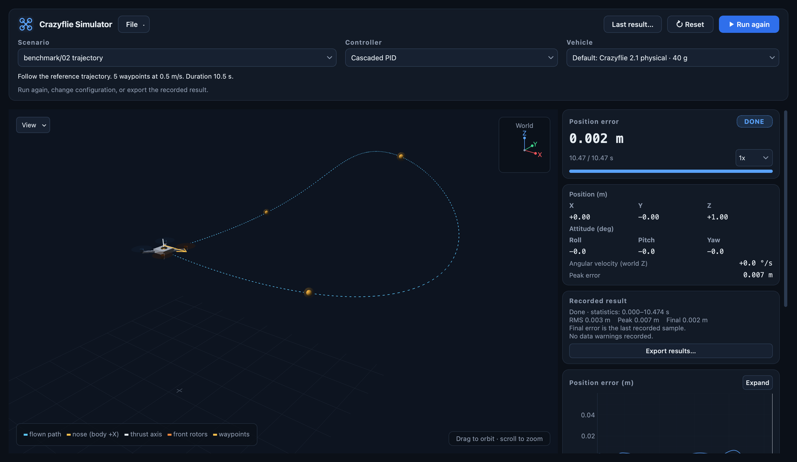

# Crazyflie Simulator

**A Python testbed for reproducible Crazyflie control and robustness experiments.**

Develop a control law, inspect its closed-loop behavior, and evaluate where
it works or fails. The simulator brings together Crazyflie vehicle models,
per-rotor actuation, configurable disturbances and faults, and a common
evaluation workflow. Built-in cascaded PID, Mellinger and LQR controllers
provide starting points for new algorithms and comparative experiments.

The focus is single-vehicle control research and teaching: trajectory
tracking, disturbance rejection, actuator faults, model uncertainty, and the
effects of estimation and command delivery. Experiments run directly in
Python, with NumPy/SciPy for numerical work and an optional live 3D view.



## What the testbed provides

- **A short path from controller code to results.** Register a Python
  controller once to use it in the live view, comparisons and benchmark.
  Controllers output per-rotor PWM and can log internal diagnostics.
- **One simulation loop.** Live runs, headless experiments and regression
  tests all use `Simulation.step`, keeping the numerical path consistent
  when moving between visual debugging and batch evaluation.
- **Explicit model mismatch.** An `ActuatorProfile` describes the nominal
  vehicle. Plant-only overrides change mass, inertia or motor response while
  the controller retains its nominal model. Monte Carlo experiments sample
  these uncertainties using the same draws for every controller.
- **Configurable actuator faults.** Inject partial or complete rotor
  effectiveness loss at a specified time, including between control ticks.
  Motor and propeller loss mechanisms, thrust curves and actuator dynamics
  support experiments with different modeling assumptions.
- **A shared evaluation protocol.** Seven standard scenarios report survival,
  tracking error, settling and PWM saturation. Stochastic cases use paired
  seeds; scorecards include bootstrap intervals and metrics for every
  replicate. Saved time series and golden regression trajectories help
  investigate results and detect behavior changes.

## Suitable experiments

| Research or teaching question | Starting point |
|---|---|
| How does a new controller track a path or reject a gust? | Add a controller and compare it with the baselines on the trajectory and hover scenarios. |
| Does good nominal performance survive a wrong vehicle model? | Use `plant_overrides` or the Monte Carlo example to vary mass, inertia and motor lag. |
| How does partial rotor loss affect stability and control authority? | Select a fault mechanism and onset, then inspect position error, rotor commands and saturation. |
| How much do state estimation and command delivery change the result? | Enable the estimator or control link and compare against the corresponding ideal-state or ideal-link run. |
| Did a controller or model change alter previous results? | Re-run the benchmark and golden trajectories in the same environment. |

The fault scenarios also provide a place to develop your own fault-tolerant
controller. The public release supplies three baseline controllers; none
survives the benchmark's complete single-rotor failure.

## Quick start

From the repository root, with Python 3.11 or newer.  First create and
activate a virtual environment, so the simulator's dependencies stay out of
your system or conda base Python:

```bash
python3 -m venv .venv                              # once
source .venv/bin/activate                          # every new shell (Windows: .venv\Scripts\activate)
pip install -e ".[gui,dev]"                        # live view and test dependencies
# For headless experiments only: pip install -e .

python runsim.py                                   # live 3D view of the default hover
python runsim.py --gui                             # pick scenario, controller and vehicle in a panel
python runsim.py hover_wind_default.yaml --controller mellinger
python runsim.py trajectory_default.yaml           # minimum-snap trajectory, Mellinger
python runsim.py trajectory_timed.yaml             # waypoints reached at given times
python -m crazyflie_sim.experiments.compare hover_rotor_fault_default.yaml \
    --fault-cases power_loss_25pct power_loss_50pct
python -m crazyflie_sim.experiments.compare hover_wind_monte_carlo.yaml --monte-carlo
python -m crazyflie_sim.experiments.benchmark      # scorecard on the standard suite
python -m unittest discover -s tests -t .          # tests, including the golden trajectories
```

The default run (`default.yaml`) takes off from the origin, climbs to 1 m in
2 s along a minimum-jerk profile and hovers there until 20 s, without wind
or rotor faults. Choose a disturbance scenario explicitly when needed.

Everything lives in the `crazyflie_sim` package.  A `CONFIG` argument is a
path, or the name of a config bundled in `crazyflie_sim/configs/` (as above;
`benchmark/01_hover_gust.yaml` for the benchmark suite).  `pip install` also
adds the commands `crazyflie-sim` (the same as `python runsim.py`),
`crazyflie-compare` and `crazyflie-benchmark`, which work from any directory.

Other environments: inside the activated `.venv`,
`pip install -r requirements.txt` gives the tested Python 3.12 dependency set
(then `pip install -e . --no-deps`).  With conda instead of venv, run
`conda env create -p ./.conda -f environment.yml` and `conda activate ./.conda`
(the reference environment), then `pip install -e . --no-deps`. That file pins macOS arm64
builds; other platforms need the build strings removed. Numerical results
can vary slightly with the NumPy/BLAS build, so keep the environment fixed
when comparing revisions.

## Interactive experiment panel

`python runsim.py --gui` (or `python runsim.py CONFIG --gui`) opens the live
view with a toolbar for choosing the run:

- **Scenario**, **Controller** and **Vehicle** come from the bundled configs and the
  registries; **File → Open/Save config…** loads or writes a complete YAML
  setup that `python runsim.py SAVED.yaml` flies the same way.
- **Trajectory…** opens a table of waypoints `t, x, y, z, ψ` (s, m, deg),
  with CSV import and export.  **Apply** flies them as a timed trajectory
  (scenario "custom (unsaved)"; **Save config…** keeps it), and the side
  panel then plots flown against reference position and yaw.
- **Start / Pause / Resume / Run again** (Space) and **Reset** (Ctrl+R) drive
  the same simulation loop as every other run; **0.25x / 0.5x** slows only
  the display.
- The side panel shows the position error, the scheduled event, the vehicle
  state and synchronized charts with a shared cursor; **Export results…**
  archives a finished or interrupted run like the command-line tools do.
- In the 3D view, drag to orbit and scroll to zoom, and **Reset view** returns
  to the starting camera; **View** shows or hides each mark: nose arrow,
  thrust axis, flown and reference paths, reference point, waypoints, wind
  arrow, world axes and a height projection.  The vehicle is drawn 2.5
  times its true size so it stays visible at metre scale.  A moving
  reference (trajectory, takeoff) is drawn as a path with a marker at the
  current reference point.
- Propellers turn at 5 rev/s in hover, scaled with each rotor's
  thrust-equivalent speed.  After a fault onset a partly failed rotor turns
  orange and slower (by its remaining effectiveness, as a cue: a controller
  that compensates restores its real speed); a failed rotor turns red and
  stops.

The full guide (chart modes, display options, result statistics, exports) is
[docs/gui.md](docs/gui.md).  `--record` and `--archive` remain direct-run
options and cannot be combined with `--gui`.

## Add a controller

1. Copy the example into the controller package:
   `cp examples/my_ctrl.py crazyflie_sim/controllers/`.  It is a complete controller in
   about forty lines: a PID loop on position and a geometric attitude loop,
   ending in per-rotor PWM.

   ```python
   import numpy as np

   from crazyflie_sim.controllers.base import ControllerBase
   from crazyflie_sim.controllers.registry import register
   from crazyflie_sim.model import actuators, params
   from crazyflie_sim.model.actuator_profile import get_actuator_profile


   @register("my_ctrl", label="My controller", color="#d62728")
   class MyController(ControllerBase):
       def __init__(self, dt, actuator_profile=None, kp=10.0, ki=8.0, kd=6.0, i_limit=1.0,
                    k_att=400.0, k_rate=30.0, yaw_weight=0.25):
           self.dt = dt  # every argument except dt and actuator_profile is a config gain
           self.actuator_profile = get_actuator_profile(actuator_profile)
           self.kp, self.ki, self.kd, self.i_limit = kp, ki, kd, i_limit
           self.k_att, self.k_rate = k_att, k_rate
           self.axis_weight = np.array([1.0, 1.0, yaw_weight])
           self.reset()

       def set_dt(self, dt): self.dt = dt
       def reset(self): self.i_err = np.zeros(3)
       def diagnostics(self): return {}

       def run(self, quad, des_state, sim_time=0.0):
           vehicle = self.actuator_profile
           # Position loop: the world-frame force that gives the desired acceleration.
           e = des_state.pos - quad.position()
           self.i_err = np.clip(self.i_err + e * self.dt, -self.i_limit, self.i_limit)
           acc = (des_state.acc + self.kp * e + self.ki * self.i_err
                  + self.kd * (des_state.vel - quad.velocity()))
           force = vehicle.mass * (acc + np.array([0.0, 0.0, params.g]))
           R = quad.rotation_body_to_world()
           thrust = force @ R[:, 2]  # what the rotors deliver along the body z axis

           # Attitude loop: desired body axes from the force direction and the yaw reference.
           z_d = force / np.linalg.norm(force)
           heading = np.array([np.cos(des_state.yaw), np.sin(des_state.yaw), 0.0])
           y_d = np.cross(z_d, heading)
           y_d /= np.linalg.norm(y_d)
           R_d = np.column_stack((np.cross(y_d, z_d), y_d, z_d))
           E = R_d.T @ R - R.T @ R_d
           e_R = 0.5 * np.array([E[2, 1], E[0, 2], E[1, 0]])  # attitude error (vee map)
           moment = vehicle.inertia @ (self.axis_weight * (-self.k_att * e_R - self.k_rate * quad.omega()))

           # Mixer, rotor limits and the PWM map of the run's vehicle: per-rotor PWM.
           return actuators.wrench_to_pwm(thrust, moment, quad.battery_voltage,
                                          actuator_profile=vehicle)
   ```

2. Fly it: `python runsim.py benchmark/01_hover_gust.yaml --controller my_ctrl`
   (or pick **My controller** in `python runsim.py --gui`).
3. Score it: `python -m crazyflie_sim.experiments.benchmark --controllers my_ctrl baseline mellinger full_state_feedback`
   flies the standard suite and writes a scorecard (see Benchmark below).  The
   example survives everything but the complete rotor loss, with larger errors
   than the baselines; replace its control law with your own.
4. Compare it on any scenario: `python -m crazyflie_sim.experiments.compare hover_wind_default.yaml --controllers baseline my_ctrl`.

Nothing else needs editing: runsim, configs, the experiment scripts and the
plots read their controller lists, labels and colours from
`crazyflie_sim/controllers/registry.py`.  Every constructor argument except `dt` and
`actuator_profile` is a gain you can set from YAML, for example
`controller_gains: {my_ctrl: {kp: 8.0}}`.  `actuator_profile` receives the
run's vehicle (the same `ActuatorProfile` the plant flies: mass, inertia,
mixer, limits); declare `DIAGNOSTICS_SHAPES = {"name": width}` to have
per-step diagnostics logged.  A controller that reports
`effectiveness_estimate` (four rotor effectiveness values) in
`diagnostics()` has it plotted against the truth in the live view.  For a
quick experiment you can also skip the registry:
`Simulation(MyController(0.002), duration_s=5.0).run()`.

## Controllers

| mode | file | notes |
|---|---|---|
| `baseline` | `pid.py` | Crazyflie-style cascaded PID (100 Hz outer, 500 Hz inner) |
| `mellinger` | `mellinger.py` | Bitcraze-style Mellinger geometric controller |
| `full_state_feedback` | `full_state_feedback.py` | LQR on the hover linearization (`model/linearization.py`); see `docs/full_state_feedback_controller.md` |

These are Python implementations for comparative experiments. Their
performance depends on the vehicle, gains, state feedback and scenario;
the benchmark below exposes both successful runs and failures. The PID and
Mellinger implementations follow Crazyflie controller structures, but do
not execute firmware code.

## Scenarios and configs

A config is a YAML file whose keys are the fields of `crazyflie_sim/sim/scenario.py:Scenario`
plus `controller_mode`, `controller_gains`, `params_overrides`, `metrics` and
`monte_carlo` (see the docstring of `crazyflie_sim/sim/config.py`).  Unknown keys are errors.

- `sim_mode`: `hovering` (hold a setpoint without disturbances),
  `hover_wind` (hold a setpoint, wind from `wind.start_time`),
  `hover_rotor_fault` (hold, then `rotor_fault`), or `trajectory`
  (minimum-snap path through `user_waypoints` at `trajectory_speed`, or a
  helix / CSV).
  In the YAML scenario interface, wind is active only in `hover_wind` and
  rotor faults only in `hover_rotor_fault`.
- `takeoff_duration_s` (hover modes, default 0): the reference climbs from
  `initial_pos` to `hover_setpoint` along a minimum-jerk profile of this
  length instead of stepping to the setpoint.
- `waypoint_source: timed` with `timed_waypoints` rows `[t, x, y, z, yaw]`
  (s, m, rad): the reference reaches each waypoint at its time `t` and holds
  the last one for 2 s.  Between two waypoints every axis and the yaw move
  monotonically (quintic segments, no overshoot), stopping where they
  reverse or hold.  The start pose is prepended at t = 0.  The LQR is
  linearized at yaw 0 and tracks to about ±45° of yaw.
- `wind`: per-axis waveforms `off | sin | constant | square | impulse |
  smoothstep | dryden` (`model/wind.py`); `as_velocity: true` makes it a wind
  velocity acting through the aero model instead of a force.
- `rotor_fault`: `case` (`power_loss_25pct/50pct/75pct`, `failure`), `rotor`
  (1..4 or a list), `start_time_s`, `mechanism` (`motor_loe`, `prop_loe`,
  `combined`).  An onset between two control ticks is applied at its exact time.
- `estimator`: close the loop on a state estimate (`backend: kalman` is the
  Lighthouse navigation EKF, `complementary` the IMU+mocap filter); `seed`
  fixes the noise. The estimator must be explicitly enabled with
  `enabled: true`; otherwise the controller receives the true plant state.
  `lighthouse_bias_shared` (one sweep-angle bias per base
  station instead of per photodiode) and `lighthouse_yaw_update` (an EKF yaw
  update from the Lighthouse sweeps) are optional sensing variants.
- `control_link`: command delay, dropout and jitter.
- `actuator_profile`: the vehicle (`model/actuator_profile.py`: mass, inertia,
  mixer, rotor limits, PWM map, motor lags, thrust curve, rotor inertia).  The
  plant flies it and every controller receives it as the nominal model;
  plant-only overrides introduce deliberate disagreement.
  `crazyflie21_physical` (default, 40 g), `crazyflie21_graefe`,
  `crazyflie21_standard` (34 g standard configuration with the identified
  thrust cubic and rotor inertia), `crazyflie21_thrust_rich` (0.5 N rotors).
- `actuator_plant_backend` (`legacy_thrust_euler` default, `thrust_exact_zoh`,
  `rotor_speed_exact_zoh`), `actuator_thrust_map` (overrides the profile's
  curve on the plant).
- `plant_overrides`: perturb the plant's copy of the vehicle only (`mass`,
  `inertia`, `motor_tau_up/down`, `rotor_inertia_kgm2`, `yaw_drag_scale`,
  ...); the controller keeps the profile, so this is a model mismatch.  The
  Monte Carlo mode samples `mass`, `I` and the motor lags this way.
- `params_overrides`: simulator-wide leaves of `model/params.py` (no vehicle
  constants), e.g. `battery_sag_enabled`, `rotor_drag_enabled`,
  `body_frame_drag_enabled`, `ground_effect_enabled`,
  `use_quaternion_attitude`.  These are the one remaining global state;
  `crazyflie_sim.sim.config.params_overridden` scopes them in headless runs.

Model details and assumptions: [realism options](docs/realism_upgrades.md).

## Benchmark

`python -m crazyflie_sim.experiments.benchmark [--controllers ...] [--scenarios ...] [--seeds N] [--reference MODE] [--jobs N]`
(or `crazyflie-benchmark ...`) flies every controller on the seven scenarios of
`crazyflie_sim/configs/benchmark/` (each an ordinary config you can also open
with `runsim.py`):

| scenario | what it tests |
|---|---|
| `hover_gust` | 0.1 N lateral gust (about 14 deg of tilt to hold) plus Dryden turbulence |
| `trajectory` | minimum-snap path, 4.2 m at 0.5 m/s with a climb |
| `partial_loss` | rotor 1 at 50 % remaining thrust effectiveness from 2 s |
| `complete_loss` | rotor 1 fails at 2 s, on the thrust-rich airframe |
| `estimator_gust` | the gust, closed on the Lighthouse navigation EKF |
| `model_mismatch` | the gust on a plant 15 % heavier, 20 % more inertia, 75 ms motor lag |
| `control_link` | the gust through a 6 ms, 5 % lossy command link |

Every run is scored from the disturbance onset to the end (from 1 s for
trajectory tracking): survival (no ground contact, finite state, tilt below
90°), RMS / peak / final position error, peak tilt, settling time to 0.1 m
and PWM saturation. Final error is averaged over the last 2 s; settling
requires remaining within the threshold for 1 s. A run that raises is
recorded as an error (not survived) and the rest of the suite still runs.

The four scenarios with randomness (Dryden turbulence, estimator noise, a lossy
link) are flown `--seeds` times (default 10): replicate k adds k to each seed,
so replicate 0 is the config as written and every controller flies the same
replicates; the deterministic ones are flown once.  Each cell reports the
median RMS error with a 95 % bootstrap interval, and the paired ratio to a
reference controller (`--reference`, default `baseline`): the geometric mean
over the seeds of RMS / RMS of the reference, marked better or worse when its
interval excludes 1.  The score is the geometric mean of those ratios over
the scenarios, so it does not depend on which other controllers flew.

The archive holds `scorecard.md` (one table across scenarios with the
survival count and score, then per-scenario detail), `scorecard.json` (every
replicate's metrics and the statistics), `scorecard.png` (median RMS error
relative to the best controller of each scenario) and per scenario an
`overview.png` plus one time series per controller, of replicate 0.
The default suite runs 129 simulations across the three built-in controllers.
Use `--jobs N` to choose the number of worker processes; `--seeds 1` flies
the configs as written only.

The built-in controllers score as follows (median RMS position error in mm,
95 % bootstrap interval; reference environment of `environment.yml`):

| scenario | seeds | Full-state LQR | Mellinger | Cascaded PID |
|---|---|---|---|---|
| hover_gust | 10 | 29.2 [27.6, 31.0] | 25.0 [24.4, 25.5] | **22.5 [20.9, 23.5]** |
| trajectory | 1 | 1.5 | **0.9** | 2.9 |
| partial_loss | 1 | **9.0** | 69.3 | 31.0 |
| complete_loss | 1 | crash | crash | crash |
| estimator_gust | 10 | 58.5 [47.2, 111] | **52.7 [37.2, 117]** | 55.4 [37.7, 105] |
| model_mismatch | 10 | crash | 45.7 [45.4, 46.0] | **25.4 [24.5, 26.3]** |
| control_link | 10 | crash | 25.0 [24.5, 25.5] | **22.5 [20.9, 23.5]** |
| survived | | 4/7 | 6/7 | 6/7 |
| score vs Cascaded PID | | 4.87 | 0.91 | 1.00 |

No built-in controller survives the complete rotor loss, and the LQR, tuned
on the nominal hover model, does not survive the mismatched plant or the
delayed link.

These results describe the configured models, gains and scenarios. They
illustrate tradeoffs between nominal performance and robustness; they do
not establish a universal ranking of control methods. Bootstrap intervals
with ten seeds are approximate, deterministic cases have only one run, and
the benchmark does not vary a custom controller's internal random seeds.
Inspect survival and per-scenario results alongside the aggregate score.

## Experiments and outputs

- `python -m crazyflie_sim.experiments.compare CONFIG [--controllers ...] [--fault-cases ...]
  [--duration S] [--monte-carlo] [--jobs N]` writes `metrics.json`, `summary.md`,
  `overview.png` and one compressed time series per controller.  With
  `--monte-carlo` the replicates fly in parallel on `--jobs` processes (default:
  every core) and give the same report as a sequential run.
- `python runsim.py CONFIG --archive` saves the live run.
- `python runsim.py CONFIG --record sim.mp4` renders a video with matplotlib
  instead of opening the live view.
- `python -m crazyflie_sim.visualization.plots RUN/a.npz RUN/b.npz -o cmp.png` overlays archived runs.

Archives go to `$SIM_RESULTS_DIR` if set, otherwise `results/runs/` under the
current directory (git-ignored in a checkout).

The command-line experiment archives include configuration and environment
metadata, including the Git revision when available. Commit the source and
retain the configuration, environment and outputs together when sharing an
experiment; a dirty-worktree flag does not preserve uncommitted source.

## Tests and the golden trajectories

`python -m unittest discover -s tests -t .` runs everything (pytest works too).
`tests/test_golden.py` re-flies six short scenarios and compares them with
`tests/golden/*.npz`.  The files carry a fingerprint of `model/params.py` and
the actuator profiles: after an intended physics or controller change, run
`python -m crazyflie_sim.tools.golden capture` and commit the new files.

Regression tests also cover trajectory derivatives, log timestamps,
complementary-filter gyro-bias convergence, video timing, the documented LQR
example and running a built wheel without the checkout.
The wheel test needs `setuptools>=77` (included in the `dev` extra and CI);
it is skipped if the build backend is not installed.

Golden trajectories check numerical regressions against stored runs. They
do not validate the model against a physical vehicle.

## Scope and current limitations

- **Physical validation is incomplete.** A validation harness against real
  flight logs remains open. Vehicle profiles and optional effects encode
  specific modeling assumptions; hardware accuracy and transfer of a tuned
  controller still need measurement and flight validation.
- **Firmware behavior is approximated.** The simulator implements its own
  Python controllers and estimators. Firmware filtering and scheduling are
  not fully reproduced, and the command-link model represents delay,
  dropout and jitter rather than a complete radio or firmware stack.
- **Observation access needs care.** Without an enabled estimator,
  controllers receive true plant state. With an estimator, unoverridden
  attributes of `EstimatedQuadView`, including rotor and fault information,
  still delegate to the plant. Define and document the measurements a new
  controller may use before making deployment or fair-comparison claims.
- **The environment is focused on single-vehicle flight.** Multi-vehicle
  interaction, camera perception and general contact/collision dynamics
  are outside the current scope. A ground-contact failure check does not
  provide a validated landing model.
- **Model options have boundaries.** The YAML modes activate wind and rotor
  faults separately. Aerodynamic coefficients and propeller radius are
  still shared across vehicle profiles. Fault mechanisms are simplified
  effectiveness models; complete rotor failure requires a controller
  designed for that operating condition.
- **Reproducibility depends on the setup.** Keep code, configuration,
  controller gains, seeds and numerical environment fixed. Small
  differences between NumPy/BLAS builds are expected; regression tests use
  tolerances, and bit-for-bit agreement across platforms is not promised.

## Model and controller documentation

- [Interactive experiment panel](docs/gui.md)
- [Nonlinear dynamics and actuation](docs/nonlinear_dynamics.md)
- [Nominal hover model and its linearization](docs/nominal_model.md)
- [Rotor-force linear model](docs/rotor_force_linear_model.md)
- [Full-state feedback (LQR) controller](docs/full_state_feedback_controller.md)
- [Cascaded PID closed-loop poles](docs/latex/cascaded_pid_transfer_function.tex) (LaTeX source)
- [Optional physics, sensing and uncertainty models](docs/realism_upgrades.md)

## Layout

```
runsim.py              run from a checkout: python runsim.py [CONFIG] [--gui]
crazyflie_sim/         the package; module paths in this README are inside it
  runsim.py            live view: one config, one controller (or --record a video)
  configs/             bundled run configs; files may `extends:` another one
  controllers/         registry.py, base.py and one file per controller
  model/               the plant: quadcopter, actuators, aero, wind, rotor faults,
                       sensors, Lighthouse, parameters, actuator profiles
  estimation/          state estimators (complementary filter, navigation EKF)
  sim/                 scenario.py (what a run flies), simulation.py (the one step
                       loop), config.py (YAML -> Scenario), trajectory, metrics, archive
  experiments/         compare.py (N controllers on one scenario), benchmark.py
                       (the standard suite), monte_carlo.py
  visualization/       live PyQtGraph view, --gui launcher, matplotlib recorder,
                       plots.py for archived runs
  tools/golden.py      capture / compare the golden trajectories
examples/              my_ctrl.py, the tutorial controller (copy it into crazyflie_sim/controllers/)
tests/                 unit tests; tests/golden/ holds the reference trajectories
docs/                  derivations, model notes and the GUI guide
```

## Contributing and citing

See [CONTRIBUTING.md](CONTRIBUTING.md) for the development workflow and the
rules that keep results comparable.  If you use the simulator in published
work, please cite it using [CITATION.cff](CITATION.cff).

## License

MIT, see `LICENSE`.  Firmware constants, the Mellinger and PID structure and
the EKF layout follow Bitcraze's open-source
[crazyflie-firmware](https://github.com/bitcraze/crazyflie-firmware); this
project is not affiliated with Bitcraze.
