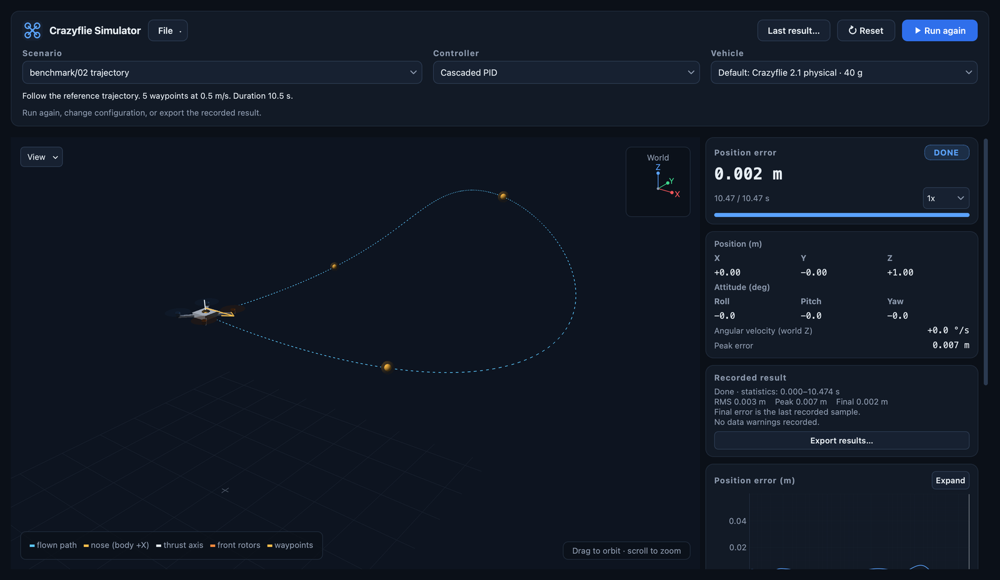

# Interactive experiment panel

The panel opened by `python runsim.py --gui` is a live view of the same
simulation loop the command-line tools use, with controls for choosing,
running, inspecting and exporting a run.

Run `python runsim.py --gui`, or `python runsim.py CONFIG --gui` to open a
particular config. The panel uses the existing PyQt6/PyQtGraph view and starts
at the initial pose, without advancing the simulation.

- Choose a **Scenario** from `crazyflie_sim/configs/` (including the benchmark suite), or
  **File → Open config…** to load a saved YAML/JSON file. Loading a scenario restores
  its controller and vehicle defaults; the other settings stay in the config.
- Choose a **Controller** and **Vehicle profile**. Both lists come from their
  registries. Vehicle profile changes are passed to both the plant and controller;
  the scenario's plant overrides and controller gains still apply.
- **Trajectory…** edits a timed trajectory: one row per waypoint with its
  arrival time `t` (s), position `x, y, z` (m) and heading `ψ` (deg). The
  table starts from the current trajectory, with the times at which it
  reaches its waypoints, or from a template. **Add row** copies the last
  waypoint 2 s later; **Import CSV…**/**Export CSV…** read and write
  `t,x,y,z,yaw_deg` files. The status line names the first invalid cell, and
  warns when the Full-state LQR is selected for headings beyond ±45°.
  **Apply** flies the table as scenario **custom (unsaved)** for its length
  plus a 2 s hold; it stays in the scenario list until replaced, and
  **File → Save config…** stores it (`waypoint_source: timed`). Trajectory
  runs add **Position** and **Yaw** charts, flown (solid) against reference
  (dashed).
- The experiment summary explains the goal, duration and scheduled disturbance
  before starting. The right panel emphasizes position error, event state and
  progress. Drag the divider to resize the 3D view and telemetry panel; expand
  **Diagnostics and setup** for raw controller values and model overrides.
  The **World** indicator in the upper-right corner follows the camera's
  orientation. The scene keeps a faint ground grid and a small origin cross;
  long world axes are hidden by default. Use **View → World axes** or
  **View → Height projection** to show either reference. The height projection
  is a faint dashed line to the ground, hidden by default. The **View** menu
  also lists every other mark the run draws, shown by default: the nose arrow
  and thrust axis, the flown path, and where present the reference path and
  reference point, the waypoints and the wind arrow. Unchecking a mark hides
  it and its legend entry. These display choices persist across Reset and
  scenario changes (for the marks a scenario shares). **Reset view**, next to the
  orbit hint in the lower-right corner, returns the camera to its starting
  position, orientation and zoom.
  The yellow **nose (body +X)** arrow rotates with the airframe; the white
  **thrust axis** points along body +Z and stays nearly vertical in level
  spinning flight. **Angular velocity (world Z)** is the world-vertical component
  of angular velocity, not the Euler yaw-angle derivative. Positive and negative
  values indicate opposite directions; oscillation around zero can accompany
  small attitude corrections without sustained spinning. Use **0.25x** or
  **0.5x** beside the simulation time to inspect fast motion; playback speed
  changes only the display timer, not the integration timestep or run data.
- One main button switches between **Start**, **Pause**, **Resume**, and
  **Run again**; Space starts, pauses or resumes. **Reset** (Ctrl+R) restores
  the initial state and random seeds. Configuration is locked while running
  or paused and editable after completion. Reset a paused run to change it.
- **File → Save config…** writes a complete YAML snapshot of the selected setup,
  including inherited settings, gains and seeds. It can be reopened in the panel
  or flown with `python runsim.py SAVED.yaml`. CSV trajectory paths are saved as
  absolute paths; the CSV itself is not copied.
- Charts retain all display samples. **Live 10 s** follows recent data;
  **Full run** shows the full time range. Dragging the time axis enters
  **Inspect**, and changing the vertical range turns off **Auto Y**. Automatic
  vertical ranges expand without shrinking; **Fit** fits the visible interval.
  **Reset view** returns every chart to its starting view: **Live 10 s**,
  **Auto Y** with ranges fitted afresh, and the cursor on the latest sample.
  The charts share a cursor: hover, enter a time, or use **Previous**/**Next**
  to inspect values. **Expand** opens a larger synchronized chart.
- On completion, the result shows RMS, peak and final position error, the
  statistics interval and any data warnings. Disturbance statistics start at
  the event; trajectory statistics cover the full run. If a run ends before
  the event, post-event metrics are unavailable. Final error is the last sample.
  Completion itself is not a control-performance rating.
- **Last result…** retains the latest completed or interrupted run across
  Reset and configuration changes. **Export results…** creates a fresh
  timestamped directory under a chosen parent (default `$SIM_RESULTS_DIR`,
  otherwise `results/runs/`) containing full-resolution `timeseries.npz`,
  resolved `config.yaml`, `env.json` and `metrics.json`. Interrupted runs with
  recorded samples can also be exported. Unavailable JSON numbers are `null`.
  Only the latest ended run is retained in memory; export it before replacing
  it with another result or closing the window. CSV trajectory files remain
  external dependencies and are not copied into archives.

The original direct-run commands still start immediately. `--record` and
`--archive` remain direct-run options and cannot be combined with `--gui`.

In the 3D view, drag to orbit and scroll to zoom; the vehicle is drawn
2.5 times its true size so it stays visible at metre scale. A moving
reference (a trajectory, or the default takeoff) is drawn as a thin amber
path with a white marker at the current reference point.

The propellers turn at 5 rev/s in hover instead of the real ~300 rev/s, which
the 50 fps view would alias, scaled with each rotor's thrust-equivalent speed
`sqrt(f / f_hover)`. From a fault's onset, a partly failed rotor is drawn
orange and turns slower by its remaining effectiveness; this is a display
cue, since a controller that compensates restores the rotor's real thrust
and speed. A completely failed rotor is drawn red and stands still, without
its blur disc.
